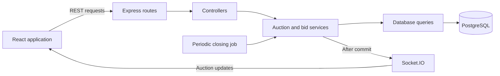

# RFQ Auctions

A request-for-quotation application with British Auction bidding. Buyers create RFQs, and suppliers compete by lowering their quotes. Qualifying bids can extend the auction up to a fixed forced-close time.

## Stack

- React, React Router, and Vite with plain CSS
- Node.js and Express
- PostgreSQL with the `pg` driver
- Socket.IO for live auction updates

The British Auction RFQ application is deployed on Vercel.
Link - https://british-auction-rfq-dusky.vercel.app/rfqs

## High-level design



React displays RFQ forms, supplier rankings, and auction activity. Express handles requests through routes and controllers, while services apply bidding and extension rules. Query modules read and write PostgreSQL data.

Bid submission locks the RFQ row and saves the bid, deadline changes, and activity entries in one transaction. Socket.IO notifies clients after the transaction commits. A periodic job records auction closure and checks expired auctions again after a restart.

The listing, RFQ creation, bidding, rankings, history, automatic closing, and live updates are implemented. See the [full HLD](docs/hld.md) for the API outline, data relationships, and processing details.

## Requirements

- Node.js 24 recommended (`nvm use`); Node.js 22.13+ on the 22.x line also works
- npm
- PostgreSQL (verified with version 17)

## Local setup

From the repository root:

```sh
npm ci
cp server/.env.example server/.env
cp client/.env.example client/.env
```

Create a PostgreSQL database named `rfq_auctions`, for example with `createdb rfq_auctions`. Update `DATABASE_URL` in `server/.env` to match your PostgreSQL username, password, host, and database name. The example uses `postgres:postgres`; replace those credentials with your local settings.

Then apply the schema, add the sample data, and start the applications:

```sh
npm run db:migrate
npm run db:seed
npm run dev
```

Open http://localhost:5173. The API runs on http://localhost:4000.

`npm run db:seed` adds three suppliers and two sample RFQs: an active Any bid auction (DEMO-001) and an upcoming L1 change auction (DEMO-002). Each is inserted only if its reference is missing. Rerunning the seed preserves existing RFQs, bids, and deadlines. Use the creation form to add a fresh auction after these samples expire.

Vite forwards `/api` requests and `/socket.io` connections to Express. If port 4000 is already in use, change `PORT` in `server/.env` and update `API_PROXY_TARGET` in `client/.env` to match, then restart the applications.

## Commands

For hosting the frontend, API, and closing worker in one Vercel project, see the [deployment guide](docs/deployment.md). PostgreSQL is connected through Vercel's Neon integration. Production builds use two-second auto-refresh; local development uses Socket.IO.

| Command | Purpose |
| --- | --- |
| `npm run dev` | Run the client and server together |
| `npm run dev:client` | Run the Vite development server |
| `npm run dev:server` | Run Express with file watching |
| `npm run lint` | Check JavaScript and JSX |
| `npm run build` | Build the frontend into `client/dist` |
| `npm start` | Run the API without file watching |
| `npm run preview` | Preview the frontend build on port 4173 |
| `npm run db:migrate` | Apply pending SQL migrations |
| `npm run db:seed` | Add three suppliers and two sample RFQs |
| `npm run check` | Run lint and the frontend build |

For a local build preview, run `npm run build`, start the API with `npm start` in one terminal, and run `npm run preview` in another. Preview also forwards `/api` requests and `/socket.io` connections to the configured API server; it is for local verification, not production hosting.

Migrations run in a transaction and are tracked in `schema_migrations`. Re-running the command skips applied files. Add a new migration file for future schema changes. Seeds can also be run repeatedly and preserve existing suppliers and RFQs. Apply pending migrations before starting the API; the second migration adds a unique index for auction closure activities.

## Current functionality

- Auction listing with current lowest bids, deadlines, status labels, live updates, and manual refresh
- RFQ creation form with validation and conditional British Auction settings
- Auction details with server-synchronized countdown, quote form, ranked quotes, bid history, and activity log
- Socket.IO notifications after successful writes, reconnect recovery, and deadline refresh
- Loading, empty, error, and not-found states with responsive layouts
- Express application with separate routing, controller, and error handling
- `GET /api/health` with server time
- Development scripts, linting, and environment examples
- PostgreSQL schema with foreign keys, validation constraints, and indexes
- RFQ creation, British Auction listing, and RFQ details
- Supplier listing and repeatable demo seeds
- Validation errors, duplicate-reference handling, computed auction status, and server time
- Quote submission with server-calculated totals and supplier rankings
- All three extension triggers, repeated extensions, and forced-close clamping
- Atomic bid/deadline/activity writes, safe retries, and validation of revised quotes
- Automatic normal/forced closing with one closure activity per RFQ
- Startup reconciliation of auctions that expired during downtime
- Current supplier rankings, full bid history, and activity history endpoints

The frontend uses the real API for all forms and tables. Choose a seeded supplier in the details page to submit or revise its quote. Supplier selection is a demo identity; authentication is outside this assignment.

## Frontend pages

| Route | Purpose |
| --- | --- |
| `/rfqs` | British Auction listing |
| `/rfqs/new` | RFQ creation form |
| `/rfqs/:rfqId` | Auction details, quote submission, rankings, and history |

The listing shows British Auctions only. Regular RFQs can also be created, but they are reached through their details URL and are excluded from the auction listing. A successful creation opens the new RFQ details.

Form dates and times use the browser's local timezone and are converted to UTC before submission. The pickup/service date stays a calendar date. Currency defaults to INR; the form also offers USD, EUR, and GBP. The backend validates the submitted fields again, and errors such as duplicate references appear beside the relevant field.

Socket.IO notifications refresh prices, deadlines, rankings, and activity. Pages also refetch after reconnect, window focus, deadline transitions, and every 30 seconds as a fallback. Refresh remains available, and the listing shows when it was last updated. Tables scroll horizontally on small screens; forms use one column. Native inputs, visible focus outlines, field labels, and error descriptions support keyboard navigation.

## RFQ API

| Method | Route | Purpose |
| --- | --- | --- |
| POST | `/api/rfqs` | Create an RFQ |
| GET | `/api/rfqs` | List British Auctions with lowest bid, deadlines, and status |
| GET | `/api/rfqs/:rfqId` | Get RFQ details |
| POST | `/api/rfqs/:rfqId/bids` | Submit or revise a supplier quote |
| GET | `/api/rfqs/:rfqId/bids` | Current supplier rankings and full accepted bid history |
| GET | `/api/rfqs/:rfqId/activities` | Bid, extension, and closure activity history |
| GET | `/api/suppliers` | List suppliers |

```sh
curl -X POST http://localhost:4000/api/rfqs \
  -H 'Content-Type: application/json' \
  -d '{
    "name": "Mumbai to Pune freight",
    "referenceId": "RFQ-001",
    "bidStartTime": "2026-11-01T10:00:00+05:30",
    "bidCloseTime": "2026-11-01T11:00:00+05:30",
    "forcedCloseTime": "2026-11-01T12:00:00+05:30",
    "pickupDate": "2026-11-03",
    "britishAuctionEnabled": true,
    "triggerWindowMinutes": 10,
    "extensionMinutes": 5,
    "extensionTrigger": "ANY_BID"
  }'
```

Creation returns HTTP 201 with `{ "rfq": { ... }, "serverTime": "..." }`. References are trimmed and converted to uppercase. Each reference must be unique. Listing returns `{ "rfqs": [ ... ], "serverTime": "..." }`; regular RFQs remain accessible by ID but are excluded from the British Auction listing.

See [API details](docs/api.md) for request fields, response fields, and errors.

## Bidding

Submit quotes to `POST /api/rfqs/:rfqId/bids` using a supplier ID from `/api/suppliers` and a new UUID `requestId`. Send freight, origin, and destination charges as integer minor units of the RFQ currency. The server calculates the total and returns the accepted bid, current rankings, RFQ state, and any extension.

Revisions must lower that supplier's previous total; they can still remain above L1. Bids are accepted from the start time until strictly before the current deadline. Quote validity must be later than the submission time. Requests waiting for the RFQ lock are checked against the database wall clock after acquiring it.

Retry a submission with its original request ID and unchanged fields. A matching retry returns the original accepted bid without creating another bid or extension. Changing the quote while reusing the request ID returns 409. See [quote submission](docs/api.md#submit-a-quote) for the full contract.

The quote form accepts decimal currency amounts and converts them to exact integer minor units. It preserves the request ID after an uncertain network/server response so an unchanged retry cannot create another bid. Editing a field starts a new request.

The countdown samples API server time and advances using elapsed browser time, so an incorrect device clock does not shift the bidding window. Network latency makes the display approximate; the server always decides whether a quote arrived before the deadline. Submission is disabled before start and once the displayed deadline passes.

## Closing and recovery

Before the API starts listening, it closes RFQs that expired while the server was stopped. A background job checks again one second after each pass finishes. Each closure locks the RFQ, rechecks the latest deadline, and saves the closure fields and activity together. Competing checks cannot record duplicate closures, and an extension committed while a closer waits for the lock keeps the auction open.

An auction ending before forced close records `closeReason: "NORMAL"`; one ending at forced close records `"FORCED"`. `closedAt` is the time closure was recorded, while `currentCloseTime` remains the bidding deadline. Bid submission enforces that deadline directly, even if the job is delayed. Reads calculate the status from the deadlines, so an expired auction can display Closed before its closure record is written.

Periodic failures are logged and retried on the next pass. Other expired RFQs are still attempted if one closure fails. Shutdown waits for active requests and the current closing pass before ending the database pool.

## Health check

```sh
curl http://localhost:4000/api/health
```

```json
{
  "status": "ok",
  "serverTime": "2026-01-01T12:00:00.000Z"
}
```

Unknown routes return HTTP 404 with a JSON message. Startup requires a migrated, reachable database for reconciliation. Once running, health reports API process availability and does not query the database on each request.

## Structure

```text
client/src/
  api/           REST requests and socket subscriptions
  components/    Shared UI components
  hooks/         Shared React hooks
  pages/         Page components
  styles/        CSS
  utils/         Form validation, money, date, and timing helpers
server/src/
  config/        Environment configuration
  controllers/   Request and response handling
  db/            Database connection and queries
  jobs/          Periodic auction closing
  middleware/    Express middleware
  routes/        API routes
  sockets/       Auction rooms and live notifications
  services/      Auction and bidding rules
  utils/         Shared server helpers
  validation/    RFQ and quote input validation
server/db/
  migrations/    Versioned SQL schema changes
  seeds/         Demo suppliers and sample auctions
server/scripts/  Migration and seed commands
docs/
  hld.md
  auction-rules.md
  database-schema.md
  api.md
```

## Design

- [Architecture and API outline](docs/hld.md)
- [Auction rules and assumptions](docs/auction-rules.md)
- [Database schema](docs/database-schema.md)
- [API details](docs/api.md)

The frontend uses a simple table-and-form layout, a system font, neutral backgrounds, and a blue accent. SQL names use `snake_case`, JavaScript variables use `camelCase`, and React components use `PascalCase`.

## Review guide

| Deliverable | Location |
| --- | --- |
| HLD and architecture diagram | Above and [docs/hld.md](docs/hld.md) |
| Database schema | [Schema reference](docs/database-schema.md) and [SQL migrations](server/db/migrations) |
| Backend | [server/src](server/src) |
| Frontend | [client/src](client/src) |

The demo uses a supplier selector in place of authentication. Supplier invitations, winner selection, and production hosting are outside this assignment's scope. The API, sockets, and closing job run in one Node.js process; deployment across multiple instances would need a shared socket adapter and coordinated scheduling.

## Common setup issues

- Database connection error: start PostgreSQL, create the database, and check `DATABASE_URL` in `server/.env` against your local user and port.
- Missing table error: run `npm run db:migrate` before starting the API or seeding data.
- Empty auction list: run `npm run db:migrate` and `npm run db:seed`, or create an RFQ with British Auction enabled.
- API port already in use: set `PORT` in `server/.env` and matching `API_PROXY_TARGET` in `client/.env`, then restart both processes.
