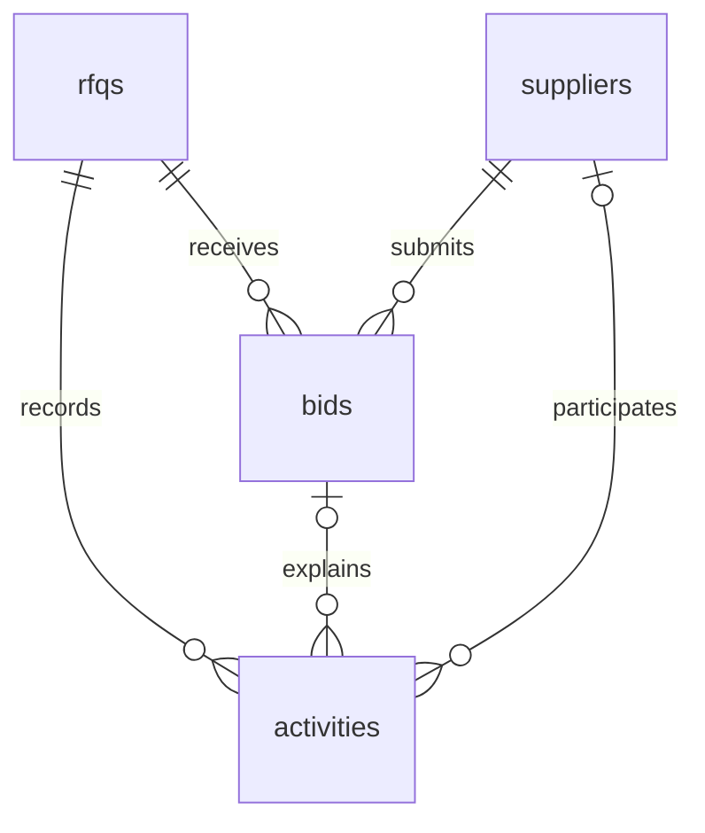

# Database schema

PostgreSQL stores RFQs, suppliers, accepted quote history, and auction activities. The initial schema is defined in `server/db/migrations/001_create_rfq_tables.sql`. Migration `002_unique_auction_closure.sql` adds the unique closure activity index.

## RFQs

| Column | Type | Purpose |
| --- | --- | --- |
| `id` | INTEGER identity, primary key | RFQ identifier |
| `name` | VARCHAR(150) | RFQ name |
| `reference_id` | VARCHAR(60), unique | Trimmed uppercase reference |
| `bid_start_time` | TIMESTAMPTZ | First permitted bidding time |
| `initial_close_time` | TIMESTAMPTZ | Original closing deadline |
| `current_close_time` | TIMESTAMPTZ | Effective deadline after any extensions |
| `forced_close_time` | TIMESTAMPTZ, nullable | Hard deadline for British Auctions |
| `pickup_date` | DATE | Pickup/service calendar date |
| `currency` | VARCHAR(3) | Currency shared by all quotes; defaults to INR |
| `british_auction_enabled` | BOOLEAN | Whether extension rules apply |
| `trigger_window_minutes` | INTEGER, nullable | X-minute trigger window |
| `extension_minutes` | INTEGER, nullable | Y-minute extension duration |
| `extension_trigger` | VARCHAR(30), nullable | ANY_BID, ANY_RANK_CHANGE, or L1_CHANGE |
| `closed_at` | TIMESTAMPTZ, nullable | Time closure was recorded |
| `close_reason` | VARCHAR(10), nullable | NORMAL or FORCED |
| `created_at`, `updated_at` | TIMESTAMPTZ | Creation and last modification times |

Checks enforce start before original close, current close at or after original close, positive X/Y settings, and a forced close later than original close. British Auctions require all extension settings and cannot extend beyond forced close. Regular RFQs have null extension settings and a fixed deadline.

Closure time and reason must both be null or both be present. Closure cannot be recorded before the effective deadline. FORCED requires a British Auction whose current deadline has reached forced close. Display status is derived from time and deadlines rather than stored as an independently editable value. Accepted bids and closure update `updated_at`; creation initializes both timestamps.

Indexes cover creation ordering and open-auction deadline scans. The unique reference constraint also provides an index.

## Suppliers

| Column | Type | Purpose |
| --- | --- | --- |
| `id` | INTEGER identity, primary key | Stable supplier identifier |
| `code` | VARCHAR(30), unique | Demo supplier code |
| `name` | VARCHAR(150) | Supplier name |
| `created_at` | TIMESTAMPTZ | Creation time |

Names and codes must be non-empty. `server/db/seeds/suppliers.sql` inserts three demo suppliers with `ON CONFLICT DO NOTHING`, preserving existing records on reruns. The seed command also runs `server/db/seeds/rfqs.sql`, which inserts two sample RFQs with fixed references and relative dates. Existing RFQs are never reset by the seed.

## Bids

| Column | Type | Purpose |
| --- | --- | --- |
| `id` | INTEGER identity, primary key | Accepted bid identifier |
| `rfq_id` | INTEGER, foreign key | Associated RFQ |
| `supplier_id` | INTEGER, foreign key | Submitting supplier |
| `request_id` | UUID | Client-generated submission identifier |
| `carrier_name` | VARCHAR(150) | Quoted carrier |
| `freight_charges` | BIGINT | Freight amount in minor units |
| `origin_charges` | BIGINT | Origin amount in minor units |
| `destination_charges` | BIGINT | Destination amount in minor units |
| `total_amount` | BIGINT, generated | Sum of the three charges |
| `transit_days` | INTEGER | Positive transit duration in days |
| `quote_valid_until` | TIMESTAMPTZ | Supplier quote validity |
| `submitted_at` | TIMESTAMPTZ | Server submission time |

Charges are non-negative and the total must be positive. Charge amounts and totals are capped at JavaScript's maximum safe integer, 9007199254740991. The database generates the total so it cannot disagree with the charge breakdown.

`(rfq_id, supplier_id, request_id)` is unique to prevent duplicate submissions. Current quotes are selected by the latest `submitted_at`, then bid ID, per supplier; previous bids remain as history. An index on `(rfq_id, supplier_id, submitted_at DESC, id DESC)` supports this lookup, and another covers supplier references.

PostgreSQL returns BIGINT values as strings through `pg`; the API converts bounded amounts to numbers explicitly. It does not replace the global BIGINT parser.

The bid API validates revised totals, quote validity, and bidding deadlines before inserting a row. It obtains an RFQ row lock first, so competing submissions see the latest supplier quote and deadline. Matching request IDs are checked under the same lock and never create another bid or extension.

## Activities

| Column | Type | Purpose |
| --- | --- | --- |
| `id` | INTEGER identity, primary key | Activity identifier |
| `rfq_id` | INTEGER, foreign key | Associated RFQ |
| `supplier_id` | INTEGER, nullable foreign key | Related supplier |
| `bid_id` | INTEGER, nullable | Related bid |
| `event_type` | VARCHAR(30) | BID_SUBMITTED, AUCTION_EXTENDED, or AUCTION_CLOSED |
| `reason` | TEXT | Readable event reason |
| `previous_close_time` | TIMESTAMPTZ, nullable | Deadline before an extension |
| `new_close_time` | TIMESTAMPTZ, nullable | Deadline after an extension |
| `created_at` | TIMESTAMPTZ | Event time |

A composite foreign key on `(bid_id, rfq_id)` ensures that a linked bid belongs to the same RFQ. Extension activities require both deadlines and a strictly later new deadline. An index on RFQ, creation time, and ID supports activity history; supplier and bid references are also indexed.

Bid and extension activities are written in the same transaction as the accepted quote and deadline update. Closure activities are written with the RFQ closure fields in their own transaction. A partial unique index on `rfq_id` where `event_type = 'AUCTION_CLOSED'` enforces one closure event per RFQ while allowing repeated bids and extensions.

The history endpoints retain all accepted bids and activity after closure. Foreign keys use the default restrictive deletion behavior so referenced auction history is not silently deleted.

## Migration tracking

The migration runner maintains `schema_migrations` with a filename primary key and application timestamp. Pending SQL files run in filename order inside a transaction. A transaction-scoped advisory lock prevents concurrent migration commands from applying the same file twice. Any failure rolls back the migration run.
