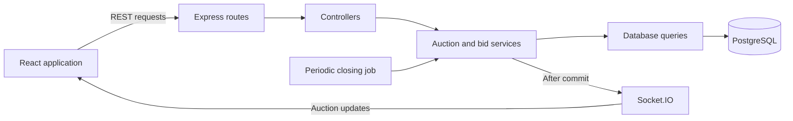

# High-level design

## Scope

The application lets buyers create RFQs with British Auction settings and lets suppliers submit progressively lower quotes. It shows current supplier rankings, auction deadlines, and a history of bids and extensions.

The application includes RFQ creation, live auction listings, quote submission, supplier rankings, bid/activity history, deadline extensions, and automatic closing.

## Architecture

One Node.js process runs the API, Socket.IO server, and periodic closing job. PostgreSQL stores the auction state and history. A single application instance is enough for the assignment.

## Responsibilities

- Routes map URLs to controller functions.
- Controllers validate request shape and return HTTP responses.
- Services apply bid validation, supplier ranking, extensions, and closing rules.
- Query modules contain parameterized SQL and accept a transaction client when required.
- React pages fetch auction state and render forms and tables. Components are extracted when shared or when a page becomes difficult to read.

## Data overview

| Table | Purpose |
| --- | --- |
| `rfqs` | RFQ details, auction configuration, deadlines, and closure information |
| `suppliers` | Stable supplier identities for the demo |
| `bids` | All accepted quotes, including revisions and their charge breakdowns |
| `activities` | Bid submissions, extensions with reasons, and closure events |

An RFQ has many bids and activities. A supplier can submit many bids across RFQs. Rankings use one current quote per supplier, while earlier quotes remain available as history. See the [database schema](database-schema.md) for columns, constraints, and indexes. Versioned SQL migrations define the schema and run through `npm run db:migrate`.

## API outline

All endpoints below are implemented. See [API details](api.md) for their contracts.

| Method | Route | Purpose |
| --- | --- | --- |
| GET | `/api/health` | API availability and server time |
| GET | `/api/suppliers` | Demo suppliers |
| POST | `/api/rfqs` | Create an RFQ |
| GET | `/api/rfqs` | List British Auctions with lowest bid, deadlines, and status |
| GET | `/api/rfqs/:rfqId` | RFQ details, configuration, and server time |
| POST | `/api/rfqs/:rfqId/bids` | Submit or revise a supplier quote |
| GET | `/api/rfqs/:rfqId/bids` | Current ranked quotes and previous submissions |
| GET | `/api/rfqs/:rfqId/activities` | Auction activity history |

## Bid submission

1. Validate the request fields and obtain a database client.
2. Begin a READ COMMITTED transaction and lock the RFQ row with `SELECT ... FOR UPDATE`.
3. Check the unique request ID. A matching retry returns the original bid/extension with current RFQ state and rankings. A changed payload returns 409.
4. Verify the supplier and load current supplier quotes.
5. Read PostgreSQL's wall clock after obtaining the lock, verify that bidding is open, and validate quote validity and any revision.
6. Insert the bid and compare rankings before and after acceptance.
7. Update the deadline if the selected trigger applies, update the RFQ modification time, and insert activity entries.
8. Build the response, commit the transaction, and publish an auction update. Rejected or replayed requests do not publish.

Every bid for the same RFQ follows this locking protocol. Each transaction uses one database client for all queries and rolls back on failure. Competing bids therefore evaluate the latest committed deadline and supplier quotes in sequence. `clock_timestamp()` is used instead of a transaction-start timestamp so a bid queued until after closing is rejected.

## Closing auctions

Startup reconciles expired auctions before the HTTP server starts listening. The periodic job then waits one second after each pass before checking again. It locks each RFQ and conditionally updates it only if it is still unclosed and its latest deadline has passed according to PostgreSQL's wall clock. An extension committed while the closer waits for the lock therefore prevents premature closure.

The closure fields and AUCTION_CLOSED activity are written in one transaction. The parent-row lock serializes competing closers and bidders; a partial unique index provides an additional guarantee of one closure activity per RFQ. Normal closure is based on a deadline earlier than forced close. Forced closure requires the effective deadline to equal forced close.

A pass attempts the other expired RFQs even if one closure fails. Periodic errors are logged, and the next pass retries remaining unclosed RFQs. Initial reconciliation errors prevent startup so a failed recovery is visible. Graceful shutdown stops new HTTP requests, cancels future checks, waits for an active pass and requests to finish, and then closes the database pool.

Bid acceptance always checks the deadline itself. The job records closure; its scheduling does not determine whether a late bid is accepted. Reads also calculate the effective status from the stored deadlines so a delayed job does not make an expired auction appear active.

A committed closure publishes an auction update to the details and listing rooms. `closedAt` records when a closer persisted the closure, which may be later than the effective bidding deadline after downtime.

## History reads

The bid endpoint returns one current quote per supplier, ranked by total, and all accepted submissions in reverse chronological order. It includes carrier, charge breakdowns, transit days, and quote validity. Expired quote validity does not remove a historical winning quote from the rankings.

The activity endpoint returns bid submissions, extensions with their reasons and previous/new deadlines, and closure records. Supplier names and codes are included where a supplier is associated with the activity; closure entries have null supplier and bid references.

Each endpoint validates the RFQ ID and reads from a read-only REPEATABLE READ transaction. Its records are committed and consistent within the response, and it does not lock the RFQ or block bid submissions. Both responses include database server time.

## Frontend and live updates

- Listing at `/rfqs`: RFQ name/reference, lowest quote, current close time, forced close time, and status. REST supplies snapshots; socket notifications refresh the listing. A manual Refresh action and last-updated timestamp remain available.
- Creation at `/rfqs/new`: RFQ details, dates, British Auction toggle, trigger window, extension duration, and trigger selection. Validation runs in the browser and again on the server; API field errors are displayed beside inputs.
- Details at `/rfqs/:rfqId`: schedule, server-synchronized countdown, ranked quotes, supplier quote form, bid history, and activity. Listing links and successful creation lead here.

React Router handles navigation and direct page URLs. Forms use local date/time controls and convert instants to UTC; service dates remain calendar dates. The layout uses plain CSS, one column for forms on small screens, and horizontal scrolling for the listing table.

The quote form converts decimal charges to exact minor units, validates lower-price revisions, and preserves the request UUID for unchanged retries after an uncertain response. The supplier selector prefills the selected supplier’s current quote.

Each page owns one socket subscription and removes listeners, timers, and pending requests on unmount. Details join `rfq:<id>`; the listing joins `auction-list`. Services publish `auction:updated` after RFQ creation, bid commit, or closure commit. Events carry an RFQ ID, event type, and notification time; clients fetch current state through REST. Joining/rejoining acknowledges room membership before the recovery fetch, avoiding a gap between subscription and snapshot.

Pages refetch on reconnect, window focus, and every 30 seconds if a notification was missed. The countdown triggers a fetch at start/close boundaries. It samples API server time with half the request round-trip delay and advances using `performance.now()`, independently of the device wall clock. Network delay makes this approximate; PostgreSQL decides whether bidding is open. The UI disables submission outside the displayed bidding window.

The socket adapter is in-memory for this single-process assignment. A multi-instance deployment would need shared pub/sub and a coordinated closing worker. Socket notifications are best-effort; committed data remains available through REST if publishing fails.

The initial layout uses plain CSS with neutral surfaces, subtle borders, and a blue accent. Controls are added when their corresponding functionality is implemented.

## Demo identity

Seeded suppliers and a supplier selector provide repeatable bidding scenarios. Full authentication, permissions, and supplier invitations are outside the assignment's initial scope. A selected supplier is a demo identity, not an authenticated account.
